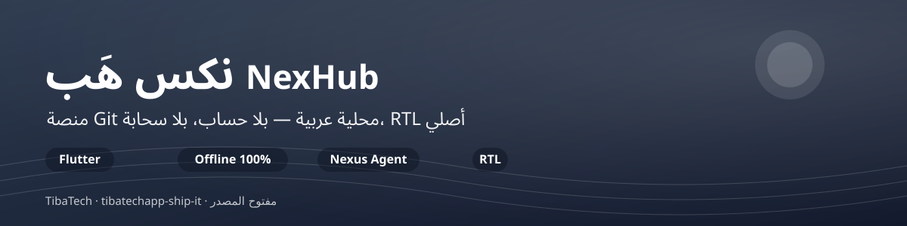

<p align="center">
  
</p>

# NexHub

منصة Git محلية عربية للمطورين — بديل لـ GitHub/GitLab/Gitea
يعمل على جهازك، بدون حساب، بدون سحابة، RTL أصلي.

## ما هو NexHub؟ (تعريف المنتج)

**NexHub = مساحة عمل تطوير محلية عربية**: عميل Git كامل + لوحة مستودعات + أدوات المطور اليومية، في تطبيق واحد يعمل **بلا حساب ولا سحابة ولا إنترنت**.

- **لمن**: المطور العربي والفرق الصغيرة الذين يريدون واجهة عربية RTL أصلية لإدارة مستودعاتهم — أو يعملون في بيئات مقيدة الشبكة.
- **ما ليس**: ليس استضافة سحابية ولا بديلاً عن خوادم GitHub — بل **طبقة واجهة عربية فوق Git على جهازك**؛ الكود لا يترك الجهاز أبداً.
- **التمايز**: العربية أولاً (RTL أصلي لا ترجمة لاحقة) + الخصوصية المطلقة (بلا حساب، بلا تتبع) + ثيم فاتح/داكن/النظام محفوظ محلياً.
- **الحالة بصراحة**: analyze صفر و38 اختباراً وCI أخضر مع نشر موقع التوثيق على Pages. القرار المتبقي على مستوى المنتج: تعميق هوية «مساحة العمل المحلية» في السرد والتجربة.

<p align="center">
  <a href="https://github.com/tibatechapp-ship-it/nexhub/actions/workflows/ci.yml"></a>
  <a href="https://github.com/tibatechapp-ship-it/nexhub/actions/workflows/build.yml"></a>
  <a href="LICENSE"></a>
  <a href="https://github.com/tibatechapp-ship-it/nexhub/releases"></a>
  
  
</p>

---

## المميزات (P0+P1+P2+P3+P4+P5+P6)

- صفر تسجيل — افتح مجلداً → ابدأ
- Offline 100% — كل شيء محلي
- عربي أولاً — RTL + خط Cairo + بحث عربي (تطبيع الألف/الياء/التاء)
- < 200ms فتح — لا انتظار
- متصفح كود + syntax highlight + Markdown
- بحث فوري في الأسماء والمحتوى ( عربي )
- Nexus Agent — وكيل AI ذكي مع function calling (7 أدوات)
- Nexus Chat — دردشة AI مع streaming و Markdown
- Nexus Memory — ذاكرة طويلة المدى (تفضيلات المستخدم)
- Diff Explain — شرح التغييرات في Commit
- Create Issue — إنشاء Issues على GitHub من داخل الدردشة
- محرر كود (edit+save) + syntax highlight
- صحة المستودع + إحصائيات + دروس
- ميزات لكل مستودع (features per repo) — تفعيل/تعطيل
- Terminal مدمج + CI + إشعارات + فريق + hooks
- 🌐 مبدّل لغة (عربي/إنجليزي/النظام) محفوظ في التفضيلات
- ⚔️ مُفسّر تعارضات دمج يُفتح تلقائياً عند الفشل
- ♿ tooltips لكل أزرار الأيقونات + تأكيدات إتلاف + حفظ بـCtrl+S
- 🌙 الوضع الليلي — مبدّل SegmentedButton (فاتح/داكن/حسب النظام) محفوظ في التفضيلات

## التراخيص

- خط Cairo المضمّن في `assets/fonts/` مرخّص بموجب
  [SIL Open Font License 1.1](https://openfontlicense.org) — النص الكامل في
  [`assets/fonts/OFL.txt`](assets/fonts/OFL.txt).

## Nexus Agent

وكيل AI ذكي يعمل داخل التطبيق مع 7 أدوات:
- `get_recent_commits` — جلب آخر Commits
- `get_commit_diff` — قراءة Diff لـ Commit
- `read_file` — قراءة ملف
- `list_files` — سرد الملفات
- `search_code` — البحث في الكود
- `apply_patch` — تطبيق تعديل
- `create_branch` — إنشاء فرع
- `save_to_memory` — حفظ تفضيل في الذاكرة
- `recall_memory` — استرجاع من الذاكرة
- `create_issue` — إنشاء Issue على GitHub

## المنصات

Android · iOS · Windows · Linux — كودبيس واحد (Flutter).

## الموقع (site/)

`site/` يحوي دليل **إعداد بيئة المطور المحلية** (React + Vite + Tailwind 4، عربي RTL):
Ollama للنماذج المحلية + MCP لربط الأدوات + Semgrep للفحص الأمني — مدمج من مستودع
`olmo` بتاريخه الكامل عبر git subtree.

```bash
cd site && npm ci && npm run dev   # http://localhost:3000
```

يُنشر تلقائياً إلى GitHub Pages من `.github/workflows/site.yml` عند أي تغيير داخل `site/`:
<https://tibatechapp-ship-it.github.io/nexhub/>

## المتطلبات

- Flutter ≥ 3.24
- `git` مثبت على الجهاز

## التشغيل

```bash
flutter pub get
dart run build_runner build --delete-conflicting-outputs
flutter gen-l10n
flutter run -d windows    # أو linux / android / ios
```

## التطوير والاختبار

```bash
flutter analyze           # صفر ملاحظات — بوابة الـCI
flutter test              # اختبارات الخدمات (git_service، nexus_tools، ...)
```

> ملاحظة: بعد أي تعديل على ملفات ARB أعِد `flutter gen-l10n` قبل التشغيل
> (ملف التوليد مُتجاهل في .gitignore ولا يُرفع).

## لقطات

| الواجهة | الميزة المعروضة |
|---|---|
|  | منصة Git عربية محلية بوكيل AI مدمج |

<!-- 💡 لقطات حقيقية: أضف PNG من التطبيق الحي في .github/assets/ وأدرجها هنا -->

## الخصوصية

لا يجمع NexHub أي بيانات. مستودعاتك تبقى على جهازك.

## المساهمة

نرحب بمساهماتك! اقرأ [CONTRIBUTING.md](CONTRIBUTING.md) (بيئة التطوير، بوابات الجودة، سير العمل)، و[SECURITY.md](SECURITY.md) للإبلاغ الأمني. الـIssues والـPRs لهما قوالب جاهزة تسهّل الأمر.

## سجل التغييرات

اطّلع على [CHANGELOG.md](CHANGELOG.md) لمعرفة ما الجديد في كل إصدار.

## الترخيص

MIT
