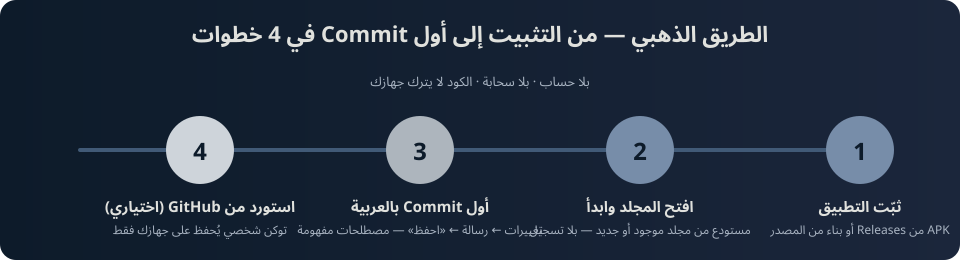

# البدء السريع — من التثبيت إلى أول Commit

> الطريق الذهبي: أسرع مسار من «حمّلت التطبيق» إلى «أول commit محفوظ» —
> بلا حساب، بلا سحابة، وبلا قراءة أي توثيق آخر. الخطوات أدناه مطابقة
> لجولة أول التشغيل المدمجة في التطبيق (5 خطوات، مُختبَرة widget-wise).

<p align="center">
  
</p>

---

## الخطوة 0 — التثبيت (دقيقة واحدة)

**الأسهل — حزمة جاهزة:**
حمّل APK لأندرويد (أو MSIX لويندوز) من صفحة [Releases](https://github.com/tibatechapp-ship-it/nexhub/releases) — الإصدار الموسوم الأحدث.
أندرويد: اسمح «التثبيت من مصادر غير معروفة» عند أول تثبيت، ثم افتح الملف.

**من المصدر (للمطورين):**

```bash
git clone https://github.com/tibatechapp-ship-it/nexhub.git
cd nexhub
flutter pub get
flutter run -d linux   # أو -d windows / جهاز أندرويد موصول
```

- شرط واحد: Flutter ≥ 3.24 (CI يبني بـ3.41.9 stable).
- التوليد المحلي مطلوب قبل أول بناء: `dart run build_runner build --delete-conflicting-outputs` ثم `flutter gen-l10n` (نفس ما تفعله وظيفة البناء في CI).

## الخطوة 1 — افتح التطبيق: جولة أول التشغيل

أول فتحة يوجّهك NexHub تلقائياً إلى `/onboarding` — خمس شاشات قصيرة تشرح
الفكرة (تُعرض مرة واحدة فقط، ويُحفظ تخطيّها أو إتمامها):

1. **أهلاً بك في NexHub** — مساحة عمل المطوّر العربية على جهازك.
2. **افتح مجلدك وابدأ** — مستودع من مجلد موجود أو جديد.
3. **اعمل أول Commit بالعربية** — واجهة Git بمصطلحات مفهومة.
4. **بلا إنترنت… وبلا سحابة** — الكود لا يترك جهازك.
5. **وكيل AI وأدوات يومية** — من الشريط الجانبي متى شئت.

اضغط «ابدأ الآن» أو «تخطي» — كلاهما لا يعيد الجولة ثانيةً.

## الخطوة 2 — أنشئ مستودعك («افتح المجلد وابدأ»)

من الشاشة الرئيسية: **«افتح المجلد وابدأ»** ← اختر مجلداً موجوداً (مشروعك
القديم) أو أنشئ مجلداً جديداً. لا تسجيل ولا إعدادات — هذا هو المستودع.

## الخطوة 3 — أول Commit بالعربية

من تبويب Git:

1. سترى **التغييرات** الجاهزة (ملفات جديدة/معدلة).
2. اختر ما تريد حفظه، واكتب **رسالة commit** بالعربية.
3. اضغط **«احفظ» (Commit)** — ستجدها في **السجل** بالتاريخ والفروع.

كل المصطلحات عربية أصلية (RTL) — لا ترجمة حرفية لاحقة.

## الخطوة 4 (اختيارية) — استورد مستودعاً من GitHub

تعمل على مستودع موجود في GitHub؟ من ميزة **GitHub**:

1. أنشئ **توكن وصول شخصياً** من إعدادات GitHub (نطاق `repo`).
2. أدخله في إعدادات NexHub — **يُحفظ على جهازك فقط** (لا خادم يراه).
3. استورد/استنسخ المستودع — وبعدها الدفع والسحب من التبويب نفسه.

> ملاحظة صدق: النسخ الحالية تعمل offline أولاً؛ مزامنة GitHub تحتاج اتصالاً لحظة الاستيراد والدفع فقط.

## تحقّق أن كل شيء يعمل (30 ثانية)

- [x] الجولة الأولى ظهرت مرة واحدة ولم تعد.
- [x] مستودعك يظهر في لوحة المستودعات.
- [x] أول commit ظاهر في السجل برسالته.
- [x] أطفأت الشبكة والتطبيق يشتغل كأن شيئاً لم يكن.

عالقتك؟ [Issues](https://github.com/tibatechapp-ship-it/nexhub/issues) — والخطوة التالية الطبيعية: [المساهمة](../CONTRIBUTING.md).
